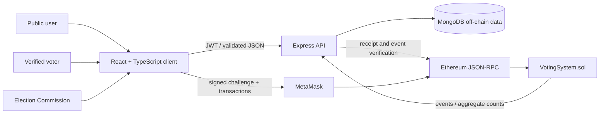

# Architecture



## Data boundaries

| Off-chain in MongoDB | On-chain in `VotingSystem` |
|---|---|
| Name, email, bcrypt password hash | Election schedule and state |
| SHA-256 voter-ID hash | Eligible wallet and optional voter-ID hash |
| Wallet/account association | Ballot commitment and `hasVoted` flag |
| AES-GCM encrypted ballot recovery payload | Aggregate candidate counts after reveal |
| Receipts and admin audit logs | Transaction/event evidence |

Raw voter IDs, OTPs, passwords, private keys, email addresses, names, and biometrics never enter the contract.

## Registration and authentication

```mermaid
sequenceDiagram
  participant V as Voter
  participant A as API
  participant M as MongoDB
  participant E as Email
  V->>A: name, email, voter ID, password, wallet
  A->>A: validate; SHA-256 ID; bcrypt password
  A->>M: unique inactive account + hashed OTP
  A->>E: 6-digit expiring OTP
  V->>A: OTP
  A->>M: activate account
  A-->>V: short-lived JWT
```

## Voting and verification

```mermaid
sequenceDiagram
  participant V as Voter + MetaMask
  participant A as API
  participant C as Smart contract
  V->>A: authenticated wallet challenge
  A-->>V: nonce message
  V->>A: wallet signature + candidate
  A->>A: verify signature; create salt and commitment; encrypt recovery payload
  A-->>V: commitment
  V->>C: castVote(election, commitment)
  C->>C: eligibility + time + duplicate checks
  C-->>V: VoteCasted event / receipt
  V->>A: transaction hash
  A->>C: verify receipt and exact event fields
  A-->>V: stored verifiable receipt
```

After closing, the authenticated voter requests the sealed recovery package and sends `revealVote`. Once every accepted commitment is revealed, the commission can call `publishResults`; the result endpoint reads contract counts, not MongoDB totals.
